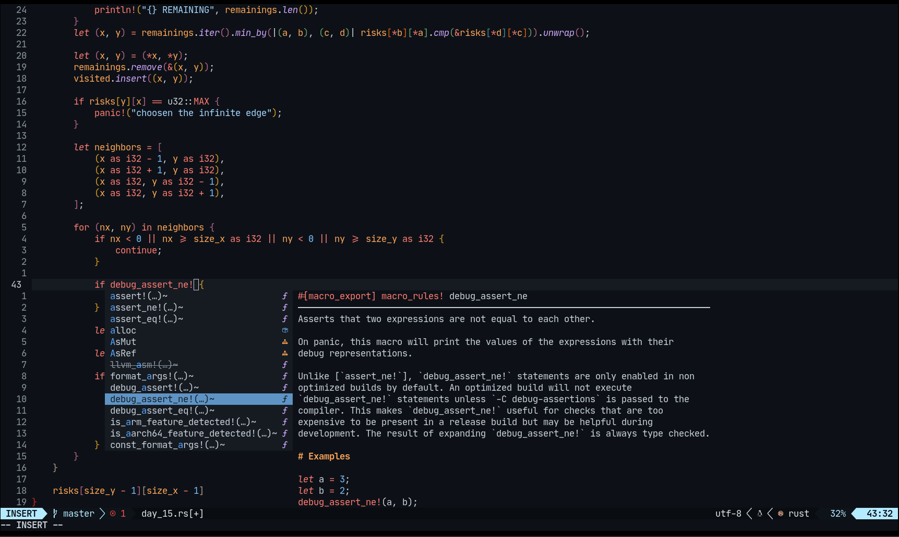

# Neovim config



Requires Neovim 0.12, a Nerd Font and the `tree-sitter` CLI, which nvim-treesitter uses to build parsers.

## Setup

lazy.nvim installs itself and the plugins on first start, and nvim-treesitter installs the parsers.

Install the language servers by hand:

```
:MasonInstall clangd lua-language-server rust-analyzer ty
```

`tsgo` runs from a project's own TypeScript 7 install, so it needs no global binary.
## Keybindings

| Key                 | Action                               |
|---------------------|--------------------------------------|
| `<space><space>`    | Find file                            |
| `<space>a`          | Grep                                 |
| `<space>w`          | Grep current word                    |
| `<space>b`          | Search open buffers                  |
| `<C-f>`             | Search lines in current buffer       |
| `<C-e>`             | File explorer                        |
| `<C-h/j/k/l>`       | Switch window                        |
| `{` / `}`           | Previous / next buffer               |
| `g-`                | Delete buffer                        |
| `g=`                | Delete all other buffers             |
| `<C-t>`             | Toggle terminal                      |
| `<space>l`          | Lazygit                              |
| `<space>L`          | Lazygit log                          |
| `<C-c><C-c>`        | Clear search highlight               |

### LSP

| Key                 | Action                               |
|---------------------|--------------------------------------|
| `gd`                | Definitions                          |
| `grr`               | References                           |
| `gO`                | Document symbols                     |
| `<space>f`          | Format buffer                        |
| `<space>e`          | Show line diagnostics                |
| `<space>]`          | Next diagnostic                      |
| `<space>[`          | Previous diagnostic                  |

Neovim's defaults also apply, including `K` for hover, `grn` for rename and `gra` for code actions.
